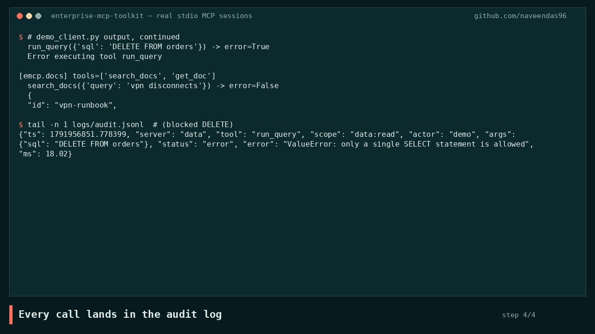

# Enterprise MCP Toolkit

**Governed Model Context Protocol servers** that plug enterprise systems into Claude Desktop, Cursor or any MCP client, with the controls a security review will ask for: scoped permissions, read/write separation, input validation, an audit trail, a kill switch that stops every tool call, and a server card that lists the only servers and tools that may be called.

[](docs/demo/demo.mp4)

*Demo recorded from the real CLI output ([MP4](docs/demo/demo.mp4)). More projects: [thenavasoft.com/projects](https://thenavasoft.com/projects.html)*

| Server | Tools | Scope(s) |
|---|---|---|
| `mcp-itsm` (mock ITSM) | `get_ticket`, `search_tickets` · *write:* `create_ticket`, `update_ticket_state` | `itsm:read`, `itsm:write` |
| `mcp-data` (DuckDB) | `list_tables`, `run_query` (SELECT-only) | `data:read` |
| `mcp-docs` (doc search) | `search_docs`, `get_doc` (role-filtered BM25) | `docs:read` + `MCP_ROLE` |
| `mcp-refund` (synthetic orders) | *write:* `request_refund` (eligibility, approval stub, credit — in that order) | `refund:write` |

## Problem
MCP makes it trivial to give an AI assistant tools. The hard part in an enterprise is making sure the assistant can only do what the user is allowed to do, that nothing destructive happens by accident or through prompt injection, and that every action can be audited.

## Architecture
```mermaid
flowchart LR
  C[Claude Desktop / Cursor / agent] -- stdio or HTTP --> I & D & K
  subgraph I[mcp-itsm]
    I1[Tool registry<br/>write tools only if itsm:write] --> I2[@audit scope check] --> I3[Pydantic + state machine] --> I4[(Ticket store)]
  end
  subgraph D[mcp-data]
    D1[@audit] --> D2[sqlglot: SELECT-only,<br/>allowlist, LIMIT 500] --> D3[(DuckDB read-only)]
  end
  subgraph K[mcp-docs]
    K1[@audit] --> K2[BM25 + role ACL filter] --> K3[(Markdown KB)]
  end
  subgraph R[mcp-refund]
    R1[@audit] --> R2[eligibility → approval stub → credit] --> R3[(Synthetic orders)]
  end
  I2 & D1 & K1 & R1 --> L[(audit.jsonl → SIEM)]
```

## Key design decisions
[ADR 0001](docs/adr/0001-scopes-and-tool-registration.md) scopes and tool registration · [ADR 0002](docs/adr/0002-audit-log.md) audit log · [ADR 0003](docs/adr/0003-validation.md) validation · [ADR 0004](docs/adr/0004-mcp-sdk-v2.md) SDK v2 · [ADR 0005](docs/adr/0005-kill-switch-server-card-refund.md) kill switch, server card and refund pipeline

## Kill switch and server card
Set `MCP_KILL_SWITCH=1` or call `engage_kill_switch()` to block every tool immediately. The denial is written to the audit log as `denied_by: kill_switch`. The allowlist of servers and tools lives in [data/server-card.json](data/server-card.json) (override the path with `MCP_SERVER_CARD`). A call to a server or tool that is not on the card is denied and logged as `denied_by: server_card`.

`request_refund` always runs three fixed steps in order: an eligibility check against a synthetic order catalog, a placeholder approval that records an id, and a credit. Calling those steps out of order, or skipping approval, raises an error and does not credit the order.

## Real run (`python examples/demo_client.py`, real stdio MCP sessions)
```
[emcp.itsm] tools=['get_ticket', 'search_tickets']          <- write tools hidden (read-only scope)
  search_tickets({'query': 'payroll'}) -> error=False  {"id": "INC0002", "title": "Payroll report job failed", ...}
[emcp.data] run_query(SELECT region, sum(amount) ...) -> error=False
  "sql": "... GROUP BY 1 ORDER BY 1 LIMIT 500"  rows: [["East","141600"],["North","132300"], ...]
[emcp.data] run_query({'sql': 'DELETE FROM orders'}) -> error=True
[emcp.docs] search_docs({'query': 'vpn disconnects'}) -> {"id": "vpn-runbook", "score": 1.779, ...}
```
Audit record for the blocked DELETE:
```json
{"server": "data", "tool": "run_query", "scope": "data:read", "actor": "demo", "args": {"sql": "DELETE FROM orders"}, "status": "error", "error": "ValueError: only a single SELECT statement is allowed", "ms": 19.6}
```
**Tests: 30 passed.** They cover hidden write tools, scope denial on direct calls, illegal state transitions, protocol-level schema rejection, 5 SQL attack patterns (DDL, DML, non-allowlisted table, stacked statements, `read_csv` file access), the row cap, the docs ACL, the existence oracle, secret redaction in the audit log, the kill switch, the server card, and a refund pipeline that cannot skip or reorder its three steps.

## Run it in 60 seconds
```bash
python3 -m venv .venv && . .venv/bin/activate
pip install -e ".[dev]"
make test && make demo
```
The demo opens three real stdio MCP sessions: it lists the tools each server exposes (write tools stay hidden under the default read-only scopes), runs a safe query, and shows a `DELETE` being rejected. No API key is required.

Optional: `npx @modelcontextprotocol/inspector mcp-itsm` for an interactive inspector.
- **Claude Desktop:** merge [examples/claude_desktop_config.json](examples/claude_desktop_config.json) into `claude_desktop_config.json`.
- **Cursor:** copy [examples/.cursor/mcp.json](examples/.cursor/mcp.json) into your project's `.cursor/`.
- **Docker:** `docker compose up` runs the three servers over streamable HTTP on ports 8101 to 8103.

## Cost note
**$0.** No LLM runs inside the servers. They're deterministic tools, and the LLM cost sits with whichever client calls them. The data server's row cap and the docs server's `k<=10` keep tool output small, which also keeps the client's token bill down.

## Limitations
- The ITSM backend is an in-memory mock. Swap `TICKETS` for a ServiceNow or Jira client.
- Identity comes from env vars (`MCP_ACTOR`, `MCP_ROLE`). For remote HTTP deployments, wire the SDK's OAuth `token_verifier` and derive scopes from token claims.
- There's no human-in-the-loop confirmation inside the server. It relies on the client's tool-approval UI for write tools. The refund approval step is a stub that records an id; it does not wait on a person.
- The servers don't use an LLM, so the toolkit doesn't need the pluggable LLM layer.
- The kill switch is process-local (an environment flag or an in-memory latch). It does not reach other processes by itself.

## License
MIT
